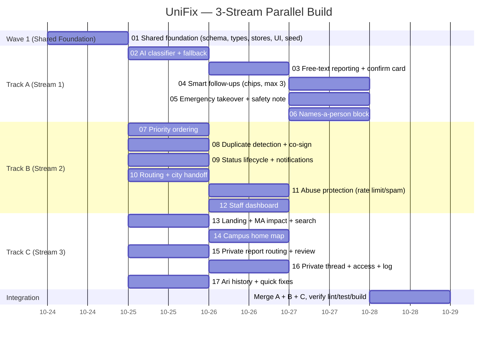

# UniFix — Gantt Roadmap (3-Stream Parallel Plan)

Wave 1 (`01-shared-foundation.md`, `Track: SHARED`) is built on `main` and pushed before anyone
branches. Then Tracks A / B / C run in parallel on separate branches/laptops; each ticket is only
blocked by `01` or tickets in its own track. Integration merges the three branches at the end.



## Track file ownership (strict isolation — no shared feature files)

| Track | Owns (folders / files) | Tickets |
| --- | --- | --- |
| **SHARED** | `supabase/`, `src/types/`, `src/lib/store/`, `src/lib/supabase/`, `src/components/ui/`, `src/components/layout/`, `src/components/ari/` (shell), `src/app/layout.tsx`, `src/app/globals.css`, `database.types.ts`, `.env.example`, `src/test/` | 01 |
| **A — intake / AI / safety** | `src/modules/ai/`, `src/modules/reporting/`, `src/modules/emergency/`, `src/app/report/`, `src/app/api/classify/` | 02–06 |
| **B — triage / staff / lifecycle** | `src/modules/priority/`, `src/modules/duplicates/`, `src/modules/notifications/`, `src/modules/routing/`, `src/modules/abuse/`, `src/modules/staff/`, `src/app/staff/`, `src/app/report-detail/`, `src/app/my-reports/`, `src/app/campus-home/`, `src/components/notifications/`, `src/components/city-handoff/` | 07–12 |
| **C — private / discovery / presentation** | `src/modules/private/`, `src/modules/campuses/`, `src/modules/ari/` (logic), `src/app/(landing)/`, `src/app/campus/[campusId]/`, `src/app/private/`, `src/app/staff-private/`, `src/components/map/`, `src/data/` | 13–17 |

> Track A owns `src/app/report/` (the report screen and its Public/Private entry point live there).
> Track C's private screens live at top-level routes `src/app/private/` and `src/app/staff-private/`
> so they never nest inside A's `src/app/report/` or B's `src/app/staff/`. If a real collision shows
> up during the build, fix it on `main` and have every track `git merge main` (per the README).

## Commands

```sh
# Wave 1 — PC #1 on main, before branching
TRACK=SHARED ./ralph/once.sh
npm run lint && npm run test && npm run build
git push origin main

# Wave 2+ — one track per PC
git checkout main && git pull && npm install
git checkout -b track-a   # (track-b / track-c on the other PCs)
TRACK=A ./ralph/once.sh   # watch the first ticket
TRACK=A ./ralph/afk.sh 10 # then let it loop   (TRACK=B / TRACK=C elsewhere)
git push -u origin track-a

# Integration — PC #1, stop loops ~1h before deadline
git checkout main && git pull
git merge origin/track-a && npm run lint && npm run test && npm run build
git merge origin/track-b && npm run lint && npm run test && npm run build
git merge origin/track-c && npm run lint && npm run test && npm run build
git push origin main
```
