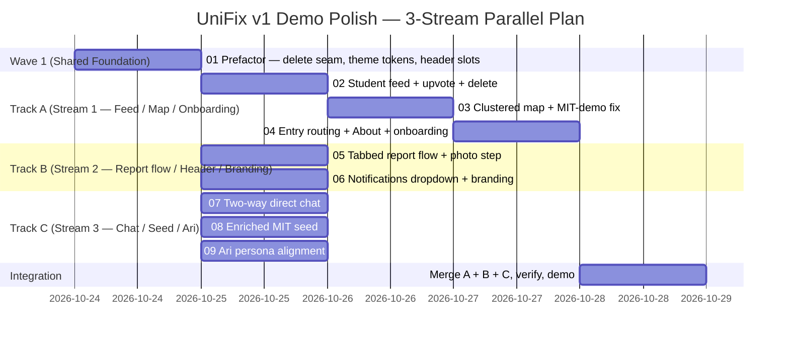

# UniFix v1 — Demo Polish Roadmap

One shared prefactor on `main`, then three strictly file-isolated tracks run in parallel on separate branches, then merge + demo.



## Track ownership (strict file isolation — zero-conflict merge)

| Track | Owns (folders/files it may create or edit) | Tickets |
| --- | --- | --- |
| **SHARED** (on `main`, first) | `src/lib/store/*` (adds `deleteReport`), `src/app/globals.css`, `src/components/ui/*`, `src/components/layout/header.tsx` (slots), `supabase/schema.sql` (cascade only if needed) | 01 |
| **A** | `src/app/campus/[campusId]/`, `src/app/(landing)/`, `src/app/about/`, `src/components/map/`, `src/packages/campuses/map/`, `src/packages/priority/`, `src/components/onboarding/` | 02 → 03 → 04 |
| **B** | `src/app/report/`, `src/modules/reporting/`, `src/components/layout/notification-bell.tsx`, `src/components/layout/university-name.tsx`, `public/logo.png`, `src/app/favicon.ico`, `design/` | 05, 06 |
| **C** | `src/app/staff-private/`, `src/app/private/thread/`, `src/packages/private/`, `src/lib/store/seed.ts`, `tools/gen-seed-sql.ts`, `supabase/seed.sql`, `src/components/ari/` | 07, 08, 09 |

Notes:
- No A/B/C ticket is `Blocked By` a ticket in another track — only by `01` or a ticket in its own track. Track A is a linear chain (the three stack on the same feed page/route); B and C tickets are independent within their track.
- The header is split into slots by `01` so Track B fills the university-name and bell slots without re-editing `header.tsx`.

## Commands

```sh
# Wave 1 — on main, PC #1, before branching:
TRACK=SHARED ./ralph/once.sh          # ticket 01
npm run lint && npm run test && npm run build
git push origin main

# Wave 2 — one track per PC, each on its own branch:
# PC #1
git checkout -b track-a && TRACK=A ./ralph/afk.sh 10
# PC #2
git checkout -b track-b && TRACK=B ./ralph/afk.sh 10
# PC #3
git checkout -b track-c && TRACK=C ./ralph/afk.sh 10

# Integration — PC #1, after the loops stop:
git checkout main && git pull
git merge origin/track-a && npm run lint && npm run test && npm run build
git merge origin/track-b && npm run lint && npm run test && npm run build
git merge origin/track-c && npm run lint && npm run test && npm run build
git push origin main
```
